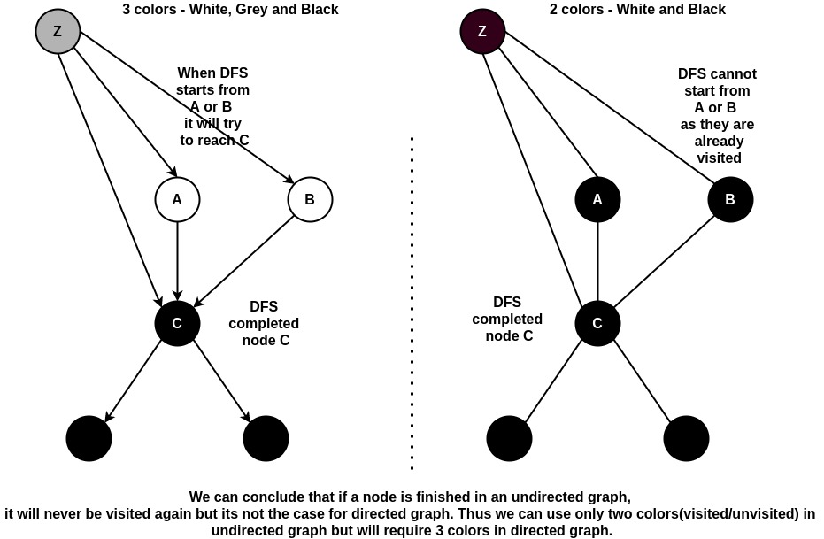

# Cycle Detection

## Overview

Consider a directed or undirected graph without self-loops and multiple edges. We need to check whether it is acyclic, and if it is not, then find any cycle.

We can use DFS to find cycles. But why do we need 2 colors in undirected graphs but 3 colors in directed graphs?

## Algorithm Analysis

| Aspect | Complexity | Notes |
|--------|------------|-------|
| **Time Complexity** | O(V + E) | DFS traversal |
| **Space Complexity** | O(V) | To store color and parent information |

## Why Different Colors for Different Graph Types?

### Undirected Graphs (2 colors)
- **WHITE**: Not visited
- **GRAY**: Currently being processed
- Any back edge to a GRAY node indicates a cycle

### Directed Graphs (3 colors)
- **WHITE**: Not visited
- **GRAY**: Currently being processed (in recursion stack)
- **BLACK**: Completely processed
- Only back edges to GRAY nodes indicate cycles (not BLACK nodes)

### The Key Difference

**Undirected Graphs**: Any back edge to a GRAY vertex **always** indicates a cycle because edges are bidirectional.

**Directed Graphs**: Not all back edges indicate cycles. A vertex can be reachable from the current path without being part of the current path. We need BLACK to distinguish between:
- **Back edge to GRAY vertex** = cycle (currently in recursion stack)
- **Back edge to BLACK vertex** = not a cycle (already processed)

**Example**: In a directed graph, if you're at vertex F and see vertex A is BLACK, it's not a cycle because A was processed earlier. But if A were GRAY, it would indicate a cycle.

## Negative Weight Cycle Detection

Negative cycles can be found using the following methods:

1. [Bellman Ford](https://github.com/gauxs/cp/blob/master/algorithms/graph/shortest_path/single_source/bellman_ford.h)
2. [Floyd Warshall](https://github.com/gauxs/cp/blob/master/algorithms/graph/shortest_path/all_pairs/floyd_warshall.h)

## References

1. [CP Algorithms - Finding Cycle](https://cp-algorithms.com/graph/finding-cycle.html)
2. [CP Algorithm - Finding negative cycle in graph](https://cp-algorithms.com/graph/finding-negative-cycle-in-graph.html)
