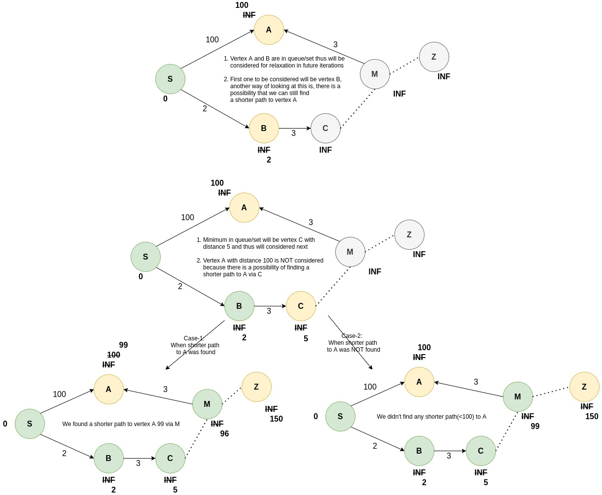

# Dijkstra's Algorithm

Dijkstra's algorithm is a greedy algorithm that finds the shortest paths from a source vertex to all other vertices in a weighted graph with **non-negative** edge weights. It's one of the most efficient algorithms for single-source shortest path problems.

## Algorithm Overview

### Purpose
- **Single-source shortest path**: Find shortest distances from source to all vertices
- **Non-negative weights**: Works only with non-negative edge weights
- **Greedy approach**: Always processes the closest unvisited vertex first
- **Optimal solution**: Guarantees shortest paths when weights are non-negative

### Key Characteristics
- **Greedy algorithm**: Makes locally optimal choices
- **Priority queue based**: Uses heap/priority queue for efficient minimum extraction
- **Works on both directed and undirected graphs**
- **Cannot handle negative weights**: Fails with negative edge weights

## How It Works

### Core Idea
The algorithm maintains a set of vertices whose shortest distances are known and a priority queue of vertices with tentative distances. At each step, it:
1. Selects the vertex with minimum tentative distance
2. Relaxes all its outgoing edges
3. Updates distances to neighbors if shorter paths are found

### Algorithm Steps
1. **Initialize**: Set distance to source as 0, all others as infinity
2. **Process**: While priority queue is not empty:
   - Extract vertex with minimum distance
   - For each neighbor, relax the edge
   - Update neighbor's distance if shorter path found
3. **Result**: Shortest distances to all vertices

### Why It Works
- **Greedy choice**: Always picking minimum distance vertex is optimal
- **Non-negative weights**: Ensures no shorter path can be found later
- **Relaxation**: Updates distances when better paths are discovered

## Important Algorithm Observations

### Critical Thinking Questions
1. **Once a vertex is relaxed, why won't it be picked again?**
   - **Greedy property**: When we pick a vertex, we've found its shortest path
   - **Non-negative weights**: No future relaxation can provide a shorter path
   - **Optimal substructure**: Shortest path to any vertex is optimal

2. **If we pick any vertex instead of minimum, why does complexity increase?**
   - **Multiple relaxations**: A vertex might be relaxed multiple times
   - **No guarantee**: We can't be sure we've found the shortest path
   - **Inefficient**: Leads to unnecessary work and higher complexity

3. **Why doesn't this work on negative edges and negative cycles?**
   - **Negative edges**: Can create shorter paths after a vertex is "finalized"
   - **Negative cycles**: Can make distances infinitely small
   - **Greedy assumption fails**: Local optimal choice isn't globally optimal

4. **Why does this work on both directed and undirected graphs?**
   - **Edge direction**: Doesn't affect the shortest path property
   - **Relaxation**: Works the same way for both graph types
   - **Non-negative weights**: The key requirement, not graph direction

## Algorithm Analysis

| Implementation | Time Complexity | Space Complexity | Best For |
|----------------|----------------|------------------|----------|
| **Array-based** | O(V² + E) | O(V) | Dense graphs (E ≈ V²) |
| **Priority Queue** | O((V + E) log V) | O(V) | Sparse graphs (E << V²) |
| **Fibonacci Heap** | O(E + V log V) | O(V) | Theoretical optimal |

### Complexity Breakdown

#### Array-based Implementation
- **Finding minimum**: O(V) for each of V vertices
- **Edge relaxation**: O(E) total
- **Total**: O(V² + E)
- **Best for**: Dense graphs where E ≈ V²

#### Priority Queue Implementation
- **Heap operations**: O(log V) for each of V extractions
- **Edge relaxation**: O(log V) for each of E updates
- **Total**: O((V + E) log V)
- **Best for**: Sparse graphs where E << V²

## Implementation Considerations

### Priority Queue Challenges
1. **Dead nodes problem**: 
   - **Issue**: Hard to remove nodes from standard heap when distance decreases
   - **Solution**: Allow duplicate entries, skip "dead" nodes when extracted
   - **Handling**: Check if extracted node's distance matches current distance

2. **Pair storage**:
   - **Structure**: Store (distance, vertex) pairs for automatic sorting
   - **Efficiency**: Enables efficient minimum extraction
   - **Memory**: Minimal overhead compared to separate arrays

3. **Set implementation**:
   - **Advantage**: Automatically handles duplicates and sorting
   - **Efficiency**: O(log V) for insert/delete operations
   - **Simplicity**: No need for separate "picked" array

### Data Structure Trade-offs
- **Array**: Simple but O(V²) time complexity
- **Binary Heap**: O(log V) operations, good for most cases
- **Fibonacci Heap**: Theoretical O(1) decrease-key, complex implementation

## When to Use Dijkstra's

**Best for:**
- **Non-negative weights**: Graph has only positive or zero edge weights
- **Single-source queries**: Need shortest paths from one source
- **Dense graphs**: When E ≈ V², array implementation is optimal
- **Sparse graphs**: When E << V², priority queue is better

**Not ideal for:**
- **Negative weights**: Use Bellman-Ford algorithm
- **All-pairs queries**: Use Floyd-Warshall algorithm
- **Binary weights**: Use 0-1 BFS for better performance

## Applications

- **Network routing**: Finding shortest paths in computer networks
- **GPS navigation**: Route planning with non-negative costs
- **Social networks**: Finding shortest connection paths
- **Game AI**: Pathfinding in games with positive costs
- **Resource allocation**: Optimizing resource distribution

## References

1. [A noob's guide to Dijkstra's algorithm](https://leetcode.com/discuss/general-discussion/1059477/A-noob's-guide-to-Djikstra's-Algorithm) by [@bliss14b](https://leetcode.com/bliss14b/) - Beginner-friendly explanation
2. [CP Algorithms - Dijkstra](https://cp-algorithms.com/graph/dijkstra.html) - Detailed algorithm explanation
3. [Wikipedia - Dijkstra's Algorithm](https://en.wikipedia.org/wiki/Dijkstra%27s_algorithm) - Mathematical properties
4. [GeeksforGeeks - Dijkstra's Algorithm](https://www.geeksforgeeks.org/dijkstras-shortest-path-algorithm-greedy-algo-7/) - Implementation guide
